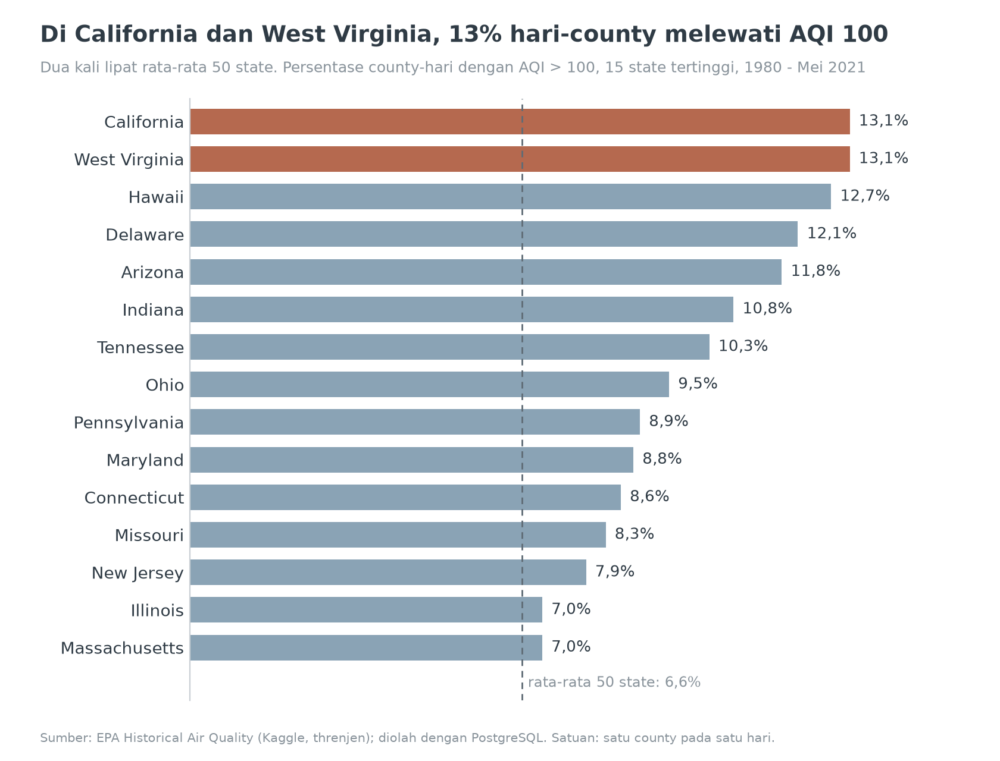
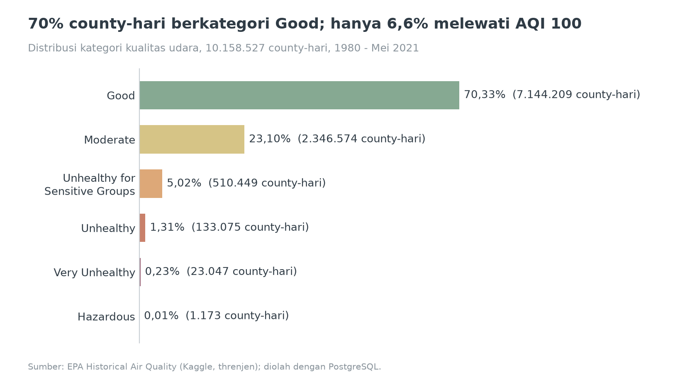
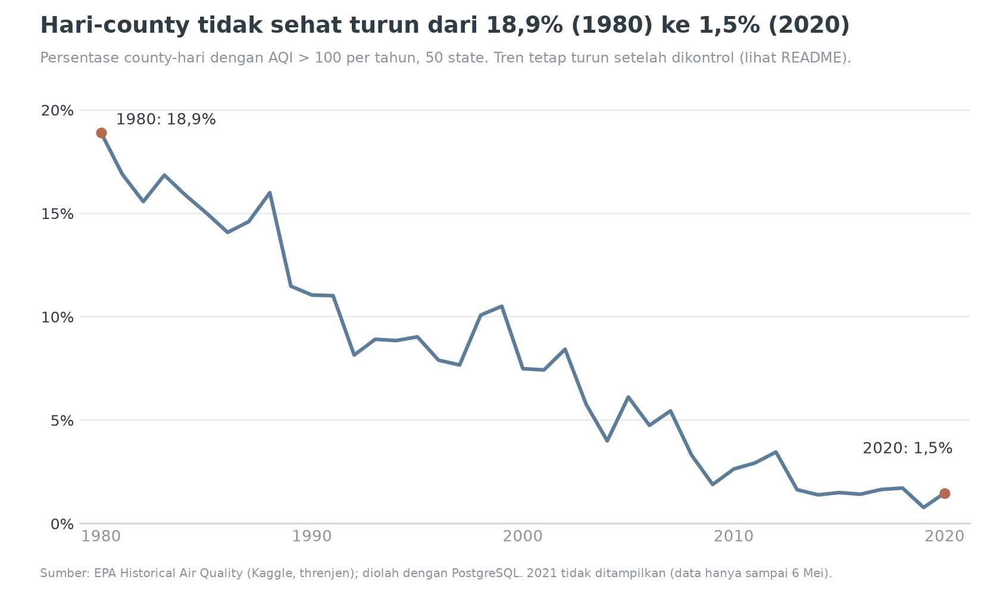
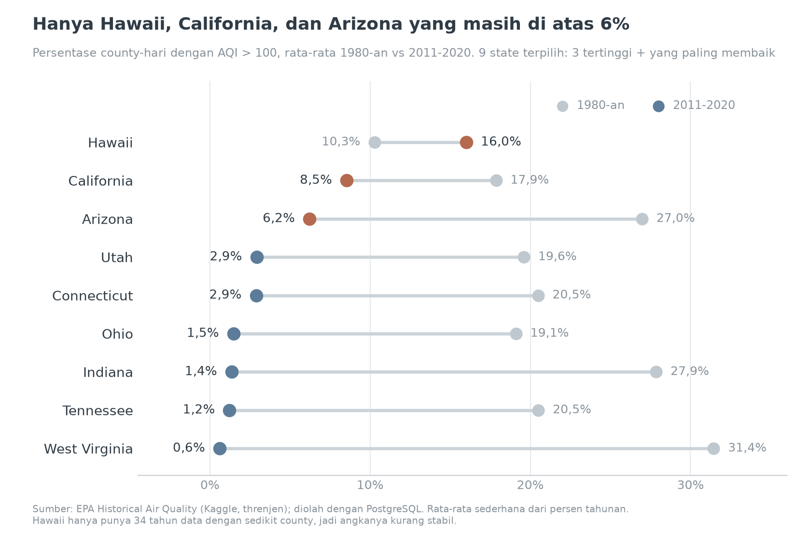
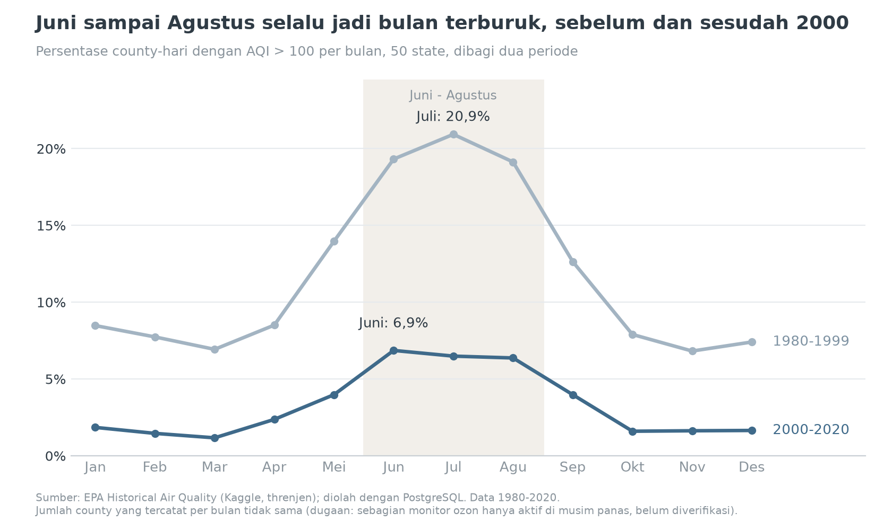
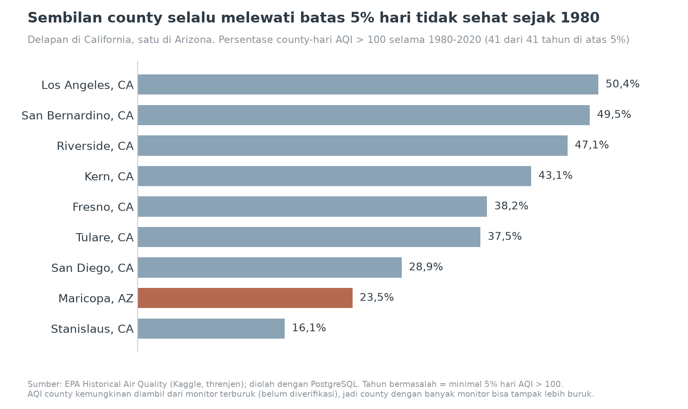
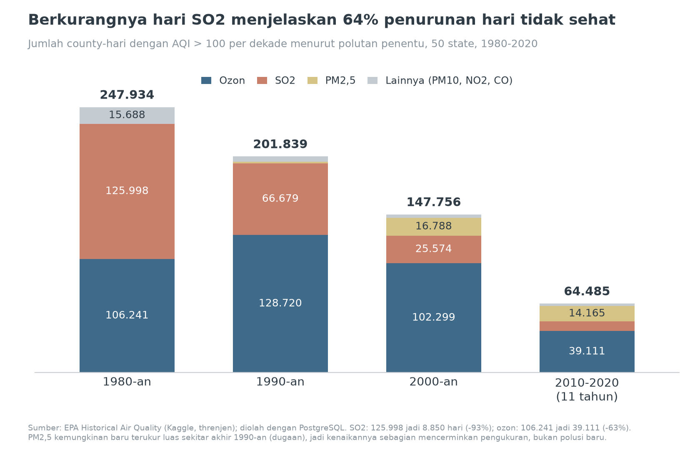

# Kualitas Udara AS 1980-2020: Hari Tidak Sehat Turun 92%, tetapi Ozon di California Selatan Bertahan

Analisis SQL (PostgreSQL) atas 10,1 juta pengukuran harian AQI dari EPA untuk menjawab: wilayah mana di Amerika Serikat yang terus-menerus melewati batas AQI 100, kapan itu terjadi, polutan apa penyebabnya, dan apakah udaranya membaik dalam 40 tahun terakhir?

## Business Problem

Analisis ini berguna untuk dinas lingkungan, kesehatan masyarakat, atau analis kebijakan yang harus memutuskan wilayah dan waktu mana yang diprioritaskan untuk pemantauan, peringatan kualitas udara, dan intervensi emisi. Pertanyaan yang dibantu jawab:

- Wilayah mana yang paling sering dan paling konsisten melewati AQI 100?
- Bulan apa yang paling berisiko, dan polutan apa yang menentukan di wilayah dan musim tersebut?
- Apakah kualitas udara membaik, dan apakah perbaikannya merata?

## Dataset

- Sumber: [EPA Historical Air Quality - 40 years of AQI (Kaggle, threnjen)](https://www.kaggle.com/datasets/threnjen/40-years-of-air-quality-index-from-the-epa-daily)
- File: `aqi_daily_1980_to_2021.csv`, sekitar 669 MB, **10.158.527 baris**, 8 kolom (state, tanggal, AQI, kategori, polutan penentu, latitude, longitude, county)
- Periode: 1 Januari 1980 sampai 6 Mei 2021
- Dataset ini hanya berisi satu file. Ringkasan tahunan dihitung sendiri dari data harian.
- Satuan analisis: **county-hari**, yaitu satu county pada satu hari. "Hari tidak sehat" berarti AQI di atas 100.

Hasil pengecekan kualitas data (query ada di `sql/02_cek_kualitas_data.sql`):

| Cek | Hasil |
|---|---|
| Nilai kosong di 8 kolom | Tidak ada |
| Format tanggal, AQI, koordinat | Valid semua |
| Duplikat (state, county, tanggal) | 0 |
| Kategori terhadap nilai AQI | Konsisten dengan skala EPA |
| AQI di atas 500 (di luar skala resmi) | 551 baris (0,005%), maksimum 20.646. Sebanyak 522 baris PM10 dan 362 baris di California. Disimpan dengan penanda `di_luar_skala`, tidak dibuang |
| Wilayah | 54 nama: 50 state, District of Columbia, Puerto Rico, Virgin Islands, dan "Country Of Mexico". Diberi kolom `jenis_wilayah`; analisis state hanya memakai 50 state |
| Koordinat per county | Tepat 1 pasang untuk masing-masing dari 1.048 county, jadi aman dijadikan tabel dimensi |
| Nama county sama di state berbeda | 109 nama (contoh: Washington ada di 13 state), jadi kunci wilayah adalah (state, county) |
| Spasi di ujung nama | 9 county di Alaska, dirapikan di tabel dimensi |
| Cakupan monitor | County yang tercatat naik dari 467 (1980) menjadi 1.040 (2020) |
| Tahun 2021 | Hanya 126 hari (sampai 6 Mei), dikeluarkan dari analisis tahunan |
| Migrasi staging ke tabel final | Jumlah baris dan total AQI (471.964.802) sama persis |

Skema akhir:

- `dim_wilayah`: 1.048 baris (`wilayah_id`, `state_name`, `county_name`, `latitude`, `longitude`, `jenis_wilayah`)
- `fact_aqi_harian`: 10.158.527 baris (`wilayah_id`, `tanggal`, `aqi`, `category`, `defining_parameter`, `di_luar_skala`)

## Tools

PostgreSQL 17, pgAdmin 4, SQL (JOIN, CTE, window function seperti `RANK`, `LAG`, rata-rata bergerak, `PERCENTILE_CONT`, serta `regr_slope`). Python (matplotlib) hanya dipakai untuk membuat chart dari hasil query. Git dan GitHub untuk dokumentasi.

## Pendekatan

1. **Cleaning.** Import CSV ke tabel staging (semua kolom TEXT) memakai `\copy`, cek kualitas data, lalu pindahkan ke tabel final bertipe benar (`DATE`, `INTEGER`) yang dipecah menjadi dimensi wilayah dan fakta harian.
2. **Analisis.** Query dasar (rata-rata AQI, hari tidak sehat, distribusi kategori), query lanjutan (peringkat per tahun, perubahan year-over-year dengan `LAG`, kemiringan tren dengan `regr_slope`, median dan persentil), lalu analisis wilayah konsisten, pola musiman, dan polutan penentu. Tren tahunan dibatasi ke 1980-2020 dan 50 state, serta diuji dengan kontrol cakupan monitor (hanya Mei-September dan hanya county yang datanya konsisten).
3. **Visualisasi.** Chart dibuat dengan matplotlib dari angka hasil query.

## Temuan Utama

**1. Udara membaik besar-besaran, tetapi sudah mendatar sejak 2013.**
- Persentase county-hari tidak sehat di 50 state turun dari **18,9% (1980) menjadi 1,5% (2020)**, atau turun 92%. Sejak 2013 angkanya bertahan di kisaran 1,4-1,7% per tahun (2019: 0,8%).
- Sebanyak 49 dari 50 state membaik. Penurunan terbesar: West Virginia (rata-rata 31,4% di 1980-an menjadi 0,6% di 2011-2020), Indiana (27,9% menjadi 1,4%), dan Tennessee (20,5% menjadi 1,2%).
- Penurunan ini bukan artefak jumlah monitor. Dengan kontrol hanya Mei-September pada county yang datanya konsisten, hari tidak sehat turun dari 23,3% (1980-1984) menjadi 3,1% (2016-2020), kemiringan -5,8 poin per dekade (R² 0,86).
- Berdasarkan polutan penentu, hari SO2 turun dari 125.998 menjadi 8.850 (-93%) dan hari ozon dari 106.241 menjadi 39.111 (-63%). Berkurangnya hari SO2 menyumbang sekitar 64% dari penurunan bersih total.

**2. Risiko saat ini terpusat di sedikit wilayah.**
- Pada 2011-2020 hanya tiga state yang masih di atas 6% hari tidak sehat: Hawaii (16,0%), California (8,5%), dan Arizona (6,2%). Di 2020, California mencatat 10,7% sedangkan rata-rata nasional 1,5%.
- Sembilan county melewati 5% hari tidak sehat di **setiap** tahun sejak 1980: Los Angeles, San Bernardino, Riverside, Kern, Fresno, Tulare, San Diego, Stanislaus (semua California), dan Maricopa (Arizona). Los Angeles County mencatat AQI di atas 100 pada 50,4% harinya selama 1980-2020.
- Rata-rata AQI menyembunyikan lonjakan. Hawaii punya median AQI 24 (terendah di antara 50 state) tetapi persentil ke-95 sebesar 200 (tertinggi).

County paling berisiko pada 2016-2020 (minimal 1.500 hari data, seluruh county pada tabel ini punya data lengkap 1.827 hari):

| County | Hari tidak sehat | Persen | Polutan dominan |
|---|---|---|---|
| Hawaii, HI | 793 | 43,4% | SO2 |
| San Bernardino, CA | 736 | 40,3% | Ozon |
| Riverside, CA | 685 | 37,5% | Ozon |
| Kern, CA | 609 | 33,3% | Ozon |
| Tulare, CA | 584 | 32,0% | Ozon |
| Los Angeles, CA | 554 | 30,3% | Ozon |
| Fresno, CA | 487 | 26,7% | Ozon |
| Gila, AZ | 445 | 24,4% | SO2 |
| Maricopa, AZ | 395 | 21,6% | Ozon |
| Kings, CA | 314 | 17,2% | PM2,5 |

**3. Musim dan polutan penentu sangat berbeda antarwilayah.**
- Bulan terburuk adalah **Juni sampai Agustus** (Juli 11,9%, Juni 11,5%, Agustus 11,2% hari tidak sehat), sedangkan Maret terendah (3,3%). Puncak di Juni-Agustus ini terlihat pada periode 1980-1999 maupun 2000-2020.
- Secara nasional (1980-2020), ozon menentukan 80,2% hari tidak sehat di musim panas. Di Los Angeles County tahun 2020, rata-rata bergerak 30 hari AQI mencapai 154,1 pada 15 September, dengan 136 dari 366 hari (37,2%) di atas 100.
- Di Hawaii, SO2 menentukan 99,4% hari tidak sehat (1980-2020), dan pada 2011-2020 porsinya hampir sama di keempat musim (98,8-99,8%). Di California, hari tidak sehat 2011-2020 didominasi PM2,5 pada musim dingin (92,9%) dan ozon pada musim panas (89,0%).

Komposisi polutan penentu per dekade (hari tidak sehat, 50 state):

| Periode | Total | Ozon | SO2 | PM2,5 | Lainnya |
|---|---|---|---|---|---|
| 1980-an | 247.934 | 42,9% | 50,8% | 0,0% | 6,3% |
| 1990-an | 201.839 | 63,8% | 33,0% | 0,8% | 2,4% |
| 2000-an | 147.756 | 69,2% | 17,3% | 11,4% | 2,1% |
| 2010-2020 (11 tahun) | 64.485 | 60,7% | 13,7% | 22,0% | 3,7% |

## Rekomendasi Keputusan

1. **Prioritaskan pengendalian ozon musim panas di California Selatan dan Central Valley.** Enam county (San Bernardino, Riverside, Kern, Tulare, Los Angeles, Fresno) mencatat 27-40% hari tidak sehat pada 2016-2020, dan ozon menentukan 89% hari tidak sehat California di musim panas (2011-2020). Peringatan dan pemantauan intensif paling bernilai pada Juni-Agustus.
2. **Siapkan peringatan SO2 terpisah untuk Hawaii.** SO2 menentukan 99,4% hari tidak sehat di sana dan hasilnya tidak mengikuti pola musim, jadi peringatan musiman umum tidak akan menangkapnya.
3. **Untuk California, tambahkan kesiapan PM2,5 di musim dingin dan gugur.** PM2,5 menentukan 92,9% hari tidak sehat musim dingin dan 39,3% musim gugur (2011-2020).
4. **Gunakan ukuran yang tahan lonjakan.** Persentase hari AQI di atas 100 dan persentil lebih informatif daripada rata-rata AQI. Rata-rata AQI Utah masuk 10 besar, tetapi persentase hari tidak sehatnya (6,7%) hanya sekitar rata-rata nasional (6,6%). Hawaii kebalikannya: rata-rata rendah (42,5), tetapi 12,7% harinya tidak sehat.
5. **Pantau apakah perbaikan nasional masih berlanjut.** Penurunannya mendatar sejak 2013, dan sisa masalahnya terpusat pada ozon, yang menurun lebih lambat daripada SO2. Target berikutnya perlu berbeda dari yang sudah berhasil menekan SO2.

Catatan: temuan di atas adalah pola pada data, bukan bukti sebab-akibat. Penjelasan penyebab (misalnya sumber SO2 di Hawaii atau asap kebakaran di California) hanya dugaan dan belum diuji di sini.

## Screenshot / Demo















## Cara Menjalankan

Kebutuhan: PostgreSQL 17, pgAdmin 4 (atau `psql`), dan Python 3 dengan `matplotlib` (hanya untuk chart).

1. Clone repo ini, lalu unduh dataset sesuai petunjuk di `data/README.md` dan taruh `aqi_daily_1980_to_2021.csv` di folder `data/`. File CSV tidak ikut repo karena ukurannya besar.
2. Buat database: `CREATE DATABASE epa_air_quality;`, lalu hubungkan pgAdmin ke database itu.
3. Jalankan `sql/01_setup_staging.sql`.
4. Import CSV dari PSQL Tool (ganti path sesuai lokasi file di komputer Anda, pakai garis miring `/`). Jalankan sekali saja, kalau diulang datanya dobel:
   ```
   \copy staging.aqi_daily_raw FROM 'C:/Projects/epa-air-quality-sql/data/aqi_daily_1980_to_2021.csv' WITH (FORMAT csv, HEADER true, ENCODING 'UTF8')
   ```
   Hasil yang benar: `COPY 10158527`.
5. Jalankan file SQL lain secara berurutan: `02_cek_kualitas_data.sql`, `03_buat_tabel_final.sql`, `03b_rapikan_nama_county.sql`, `04_query_dasar.sql`, `05_query_lanjutan.sql`, `06_analisis_wilayah_musim.sql`. Setiap file berisi banyak query. Jalankan satu per satu (blok query lalu F5), jangan seluruh file sekaligus. Bagian INSERT di `03` cukup dijalankan sekali.
6. Chart (opsional): `pip install matplotlib`, lalu jalankan keempat skrip di `scripts/` dari folder utama proyek. Angka di skrip disalin dari hasil query dan sumbernya tertulis di komentar tiap skrip.
   ```
   python scripts/buat_chart_step9.py
   python scripts/buat_chart_step10.py
   python scripts/buat_chart_step11.py
   python scripts/buat_chart_step11b.py
   ```

Perkiraan waktu proses: import CSV beberapa menit, pengisian `fact_aqi_harian` sekitar 3 menit (terukur 3 menit 15 detik), dan beberapa query berat 1-3 menit.

Struktur folder:

```
epa-air-quality-sql/
├── README.md
├── .gitignore
├── data/            petunjuk unduh dataset (CSV tidak ikut repo)
├── sql/             7 file SQL berurutan
├── images/          7 chart untuk README
└── scripts/         skrip matplotlib untuk chart
```

## Keterbatasan & Next Steps

Keterbatasan:

- AQI adalah indeks turunan: nilai harian diambil dari polutan terburuk pada hari itu, bukan konsentrasi mentah. Nilai tingkat county kemungkinan diambil dari monitor terburuk (belum diverifikasi), sehingga county dengan banyak monitor bisa tampak lebih buruk.
- Cakupan monitor berubah. County yang tercatat naik dari 467 menjadi 1.040. Rata-rata hari data per county bergerak di kisaran 279-329 hari per tahun, dan tren sudah diuji dengan kontrol Mei-September serta panel county konsisten, tetapi bias cakupan tidak bisa dihilangkan sepenuhnya.
- Pengukuran PM2,5 kemungkinan baru meluas sekitar akhir 1990-an (dugaan). Kenaikan porsi PM2,5 pada tabel polutan sebagian mungkin mencerminkan pengukuran, bukan polusi baru.
- Cara hitung AQI dan standar polutan EPA berubah selama 41 tahun. Pengaruhnya terhadap tren belum diperiksa.
- Beberapa kombinasi state-tahun awal punya sampel sangat kecil (contoh: Idaho 1980 hanya 1.456 county-hari, Hawaii 2010 hanya 1.073). Peringkat per tahun pada periode awal sebaiknya tidak dikutip sebagai fakta kuat. Ambang minimal 700 county-hari dipakai untuk peringkat tahunan.
- Ambang 5% untuk "tahun bermasalah" adalah pilihan analis, bukan standar resmi.
- Peringkat 2016-2020 sensitif terhadap 2020: di Los Angeles County, tahun 2020 saja menyumbang sekitar 25% hari tidak sehat periode tersebut.
- Satuan county-hari memberi bobot lebih pada county dengan data lebih banyak, dan state dengan sedikit county (misalnya Delaware, Rhode Island) kurang mewakili.
- Semua penjelasan penyebab bersifat dugaan, bukan hasil pengujian.

Next steps:

- Memakai data tingkat monitor EPA untuk memeriksa apakah agregasi county menggeser peringkat.
- Menambahkan data penduduk untuk menghitung paparan per kapita, bukan per county.
- Menguji dampak kejadian tertentu (misalnya kebakaran hutan 2020) dengan membandingkan hari berpolutan PM2,5 sebelum dan sesudahnya.
- Memperluas periode dengan data EPA setelah Mei 2021 dan membuat dashboard interaktif.

---

Dibuat oleh Daffa ([@Daffa-arynd](https://github.com/Daffa-arynd)).
